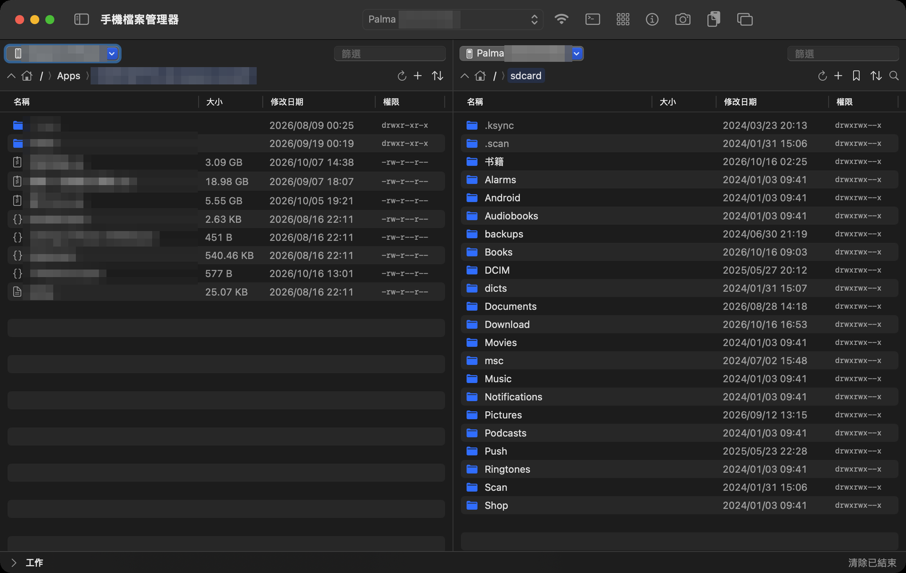
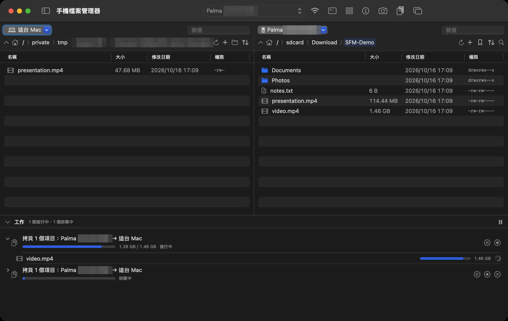
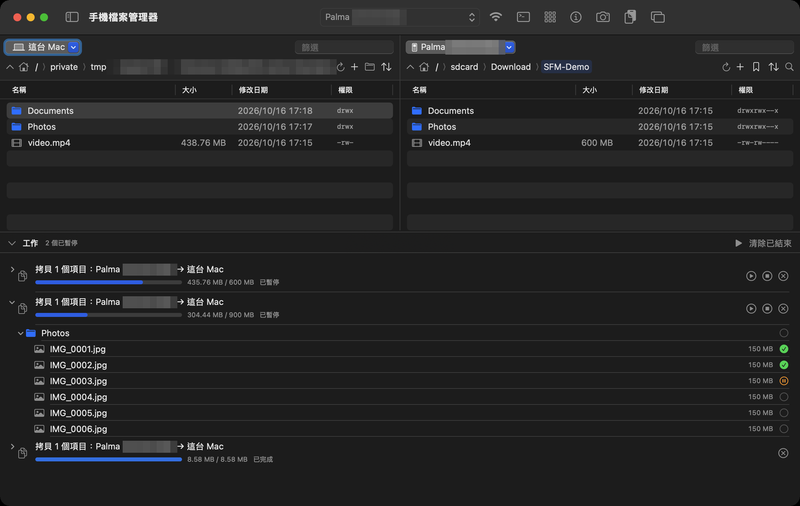
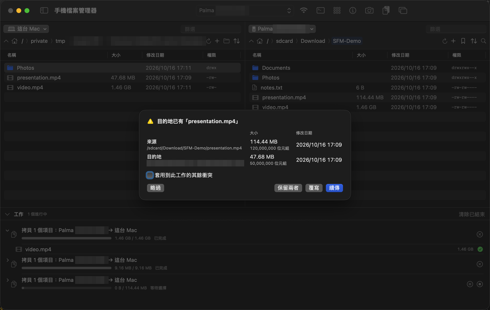
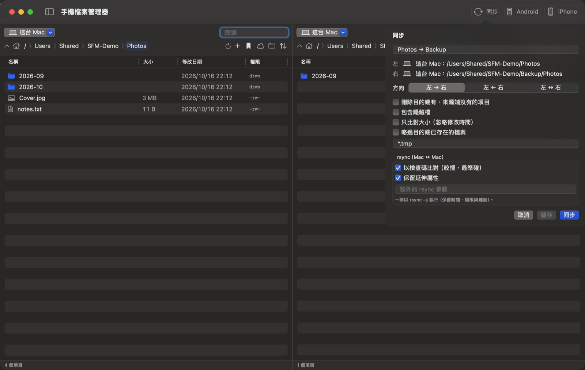
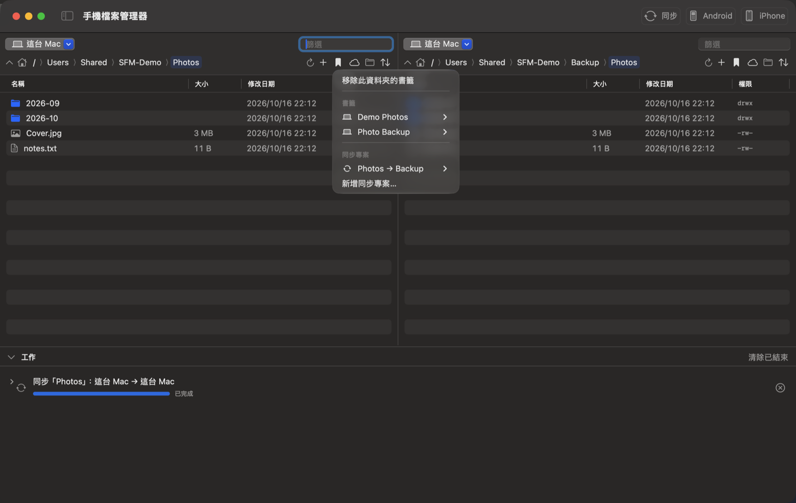

# Smartphone File Manager（macOS）

在 Mac 上同時管理 **Mac、Android、iPhone 與網路伺服器**（WebDAV、FTP／FTPS、SFTP、pCloud）檔案的雙窗格檔案管理器，以 **Swift 6 + SwiftUI** 撰寫。
源自 [wkbin/AdbFileManager](https://github.com/wkbin/AdbFileManager)（Kotlin/Compose）的 macOS 移植，
並擴充為任意來源 ⇄ 任意來源。結構：SwiftPM 套件 + `tools/make-app.sh`。

- **部署目標**：macOS 14+（開發機 macOS 27 / Xcode 27 / Swift 6.4）
- **Android**：需要 adb（`brew install --cask android-platform-tools` 或 Android SDK）；`make-app.sh` 會把找到的 adb 內附進 .app。
  repo 不收錄 adb 二進位檔（Google SDK 授權條款），見 [`THIRD_PARTY_NOTICES.md`](THIRD_PARTY_NOTICES.md)
- **MTP**（必要相依 `brew install libmtp`）：沒開 USB 偵錯的 Android、電子書閱讀器等 MTP 裝置；有 adb 的 Android 也可另選 MTP。
  根目錄列出各儲存空間（內部、SD 卡）；同儲存空間移動與小檔複製由裝置端完成，大檔／資料夾經 Mac 中繼（MTP 裝置端複製無進度且會逾時）
- **iPhone**：USB 或 **Wi-Fi**（先以 USB 接一次、在 Finder 開啟「在 Wi-Fi 上時顯示此 iPhone」，之後同網路即可；USB 與 Wi-Fi 同時存在時用 USB）。透過 libimobiledevice（`brew install libimobiledevice ideviceinstaller`）。根目錄分兩個虛擬資料夾：
  `Media`（DCIM、Downloads、Books…）與 `Apps`（開啟檔案分享的 App 及其 Documents，等同 Finder 的「檔案」分頁）
- **網路帳號**：WebDAV（https／http、自簽憑證可釘選）、FTP（純 FTP／FTPS explicit／FTPS implicit；被動／主動）、SFTP（密碼或私鑰）、
  pCloud（Email＋密碼登入、支援兩步驟驗證，美國／歐洲資料中心自動判定；OAuth 瀏覽器登入為選用）。FTP／FTPS／SFTP 需 `brew install lftp`
- **發佈**：自用、App Sandbox 關閉；簽章優先用鑰匙圈裡的 Apple Development 憑證（重新 build 不必再允許鑰匙圈存取），找不到才 ad-hoc；**語系**：English／繁體中文／简体中文（跟隨系統語言）
- **安裝導引**：缺 adb、libimobiledevice、scrcpy 時於 app 內顯示步驟、官方下載連結與一鍵安裝指令（輔助說明 → 安裝導引）

## 畫面



**工作面板**：底部可收合，樹狀展開到檔案；同一台裝置的工作依序執行（第二個排隊中）



**工作佇列**：暫停的工作保留進度；展開到檔案可見已完成 ✓、中斷待續傳（橘色）、等待中 ○，按繼續從中斷處續傳



**衝突對話框**：目的已有同名檔案時並列大小與日期；目的較小時可從中斷處續傳；另有依條件（大小、新舊）略過／覆寫／續傳的選擇



**同步（類似 rsync）**：工具列「同步」彈出視窗，專案名稱、方向（左 → 右／左 ← 右／左 ↔ 右）、選項；兩邊都是 Mac 時多出 rsync 專用選項



**書籤（兩種）**：資料夾書籤與同步專案；選同步專案會把左右窗格開到該資料夾並開啟同步視窗



（截圖中的裝置序號、裝置名稱、開發者 ID 與個人檔名已打馬賽克；同步與書籤截圖以示範資料夾拍攝）

## 功能

| 區塊 | 說明 |
|---|---|
| 雙窗格、任意來源 | **左右窗格各自**以標題的來源按鈕選擇：這台 Mac、任一 Android、任一 iPhone、任一網路帳號；同一台裝置可在兩邊同時開不同資料夾。來源與各來源最後所在資料夾都會記住，下次啟動恢復（裝置未連線時等它連上；資料夾已不存在則回起始資料夾） |
| 拷貝／剪下／貼上 | 表格焦點時 ⌘C／⌘X／⌘V；右鍵「拷貝、剪下、貼上、貼到「資料夾」」；對單檔、資料夾、多選都適用。Finder 拷貝的檔案可直接貼到裝置；Mac 項目拷貝後可貼到 Finder |
| 刪除 | Delete 鍵或右鍵；Mac 為移到垃圾桶，裝置為永久刪除（含資料夾內容），皆會確認 |
| 窗格互傳 | 右鍵「複製／移動到另一窗格」、拖放（窗格 ⇄ 窗格、Finder → 窗格、Mac 窗格 → Finder；裝置檔案存到 Mac 用「匯出」或拖到 Mac 窗格）；同 Finder：同一來源且同一磁碟區／儲存空間（移動只是改名）拖放為移動，跨磁碟（兩顆外接碟之間、手機內部 ↔ SD 卡）為拷貝；按住 Option 一律拷貝、⌘ 一律移動；不同來源及 Finder 拖入為拷貝 |
| 工作佇列 | 拷貝／移動／刪除都進入底部「工作」面板（可收合、可調高度）：樹狀展開到檔案、各自進度；**立即開始**（資料夾執行到才列出內容，不先掃描整棵樹），顯示百分比、速率與預估剩餘時間（仍在掃描時標「至少」）；並行時每個執行器一條進度（主執行器藍色、子執行器各自顏色，含檔名、百分比、速率、剩餘時間），樹狀清單中傳輸中的檔案用同樣顏色；**暫時性錯誤自動重試**：斷線、逾時、外接磁碟暫時讀不到或被卸載時，等 5 秒～5 分鐘（共約 17 分鐘）從已傳的部分接著傳，期間顯示「N 秒後重試」；網路帳號可在選項設「同時傳輸數」並行傳輸：≥ 2 時 1 個主執行器專給大檔（門檻預設 200 MB，可調）、其餘子執行器傳小檔（子執行器小檔優先、沒有小檔時也跑大檔；主執行器大檔優先，沒有大檔時接手子執行器正在下載的大檔以多連線續傳，再沒有才做小檔；只用於雲端／網路帳號）；主執行器一律以多條連線下載、子執行器單一連線（N = 1 時唯一的執行器即主執行器，每個下載都多連線）（「大檔同時連線數」：WebDAV／pCloud 分區塊 Range、FTP／SFTP `pget -n`）；暫停／繼續／停止／移除；**從工作移除單一檔案或資料夾**（滑鼠移到樹狀清單的列上按 ⓧ，或右鍵「從工作移除」；傳到一半的立即中斷並清除不完整內容，工作其餘部分照常進行；移動工作裡被移除的項目留在來源）；檔案狀態圖示：○ 等待、橘色 ⊕＝續傳（中斷過，或衝突選了續傳）、綠勾＝完成、灰色「下一首」⏭＝略過、紅驚嘆號＝失敗（滑鼠停留有說明）；每台裝置一次一個工作（不同裝置並行）；**關閉 app 後保留**，重開時為暫停、按繼續才執行；還有傳輸在進行時關閉主視窗或 ⌘Q 會先詢問「確定要結束嗎？」（詢問附在主視窗上，取消則一切不變、繼續傳輸） |
| 衝突與續傳 | **開始傳輸前先找出所有衝突、一次問完**（不會傳到一半停在對話框；目的資料夾已存在時才檢查裡面，不存在就不必掃描），答案記在每個檔案上，工作清單的檔名後顯示「已略過／續傳／覆寫」，略過時寫出原因（目的地檔案大小相同／目的地已有新的同名檔案／使用者略過），續傳的檔案圖示為橘色 ⊕；目的已有同名檔案時詢問（類似 FTP）：並列兩邊大小與日期，分兩區：「這個檔案」可選續傳／覆寫／保留兩者／略過（可勾選其餘衝突也這樣處理；不能續傳時按鈕停用並說明原因）；「其餘所有衝突，依條件」一按即套用到全部：大小相同略過且較小續傳、大小相同就略過、來源沒有較新就略過、大小相同且來源沒有較新就略過（每個檔案各自判斷；比較時間容許 2 秒誤差、日期不明視為非較新）；資料夾同名則合併。大檔從中斷處續傳：Android（`tail -c`／`exec-in`／`dd`）、MTP（Partial Object）、Mac；iPhone（AFC 無法指定位置）一律重傳 |
| 傳輸路徑 | 同裝置同檔案系統為原生 mv（瞬間）；其餘逐檔傳輸：同裝置原生 cp（不經 Mac）、跨裝置經 Mac 中繼（暫存於 Application Support，可續傳）；跨檔案系統搬移會預檢空間 |
| 檔案操作 | 新增資料夾（＋選單、右鍵、⇧⌘N 作用在最後操作的窗格）/檔案、改名、權限（Android chmod）、路徑列右鍵拷貝路徑、**從 Finder 把檔案或資料夾拖到路徑列＝窗格切到這台 Mac 並開啟該位置**（檔案則開啟所在資料夾並選取）、遞迴搜尋（Android）、排序（點名稱／大小／修改日期欄位標題，或排序選單）、篩選 |
| 編輯器 | 任一來源的文字檔：語法上色、⌘F／⌥⌘F、undo、編碼偵測與切換、無損存檔 |
| Android 工具 | 工具列「Android」按鈕彈出視窗：選擇目標裝置；終端機（多分頁）、App 管理、裝置資訊、重開機、截圖、寫入剪貼簿、scrcpy 鏡像、無線配對／連線 |
| iPhone 工具 | 工具列「iPhone」按鈕彈出視窗：選擇目標 iPhone；裝置資訊（機型、iOS、電池、儲存空間）、重新開機／關機、App 管理（列出、安裝 .ipa、解除安裝）。iOS 17 起 libimobiledevice 無法截圖，故不提供 |
| 書籤（兩種） | 窗格的書籤選單：**資料夾書籤**（任何來源，含裝置）與**同步專案**（左右一對資料夾＋方向＋選項）；只列窗格目前裝置的項目（同步專案：任一邊在此裝置），其他裝置的收在「其他裝置」子選單；選同步專案會把左右窗格開到該資料夾並開啟同步視窗。存於 `Application Support/SmartphoneFileManager/bookmarks.json`，首次啟動匯入舊版 `~/.adbfilemanager/bookmarks.json` |
| 時間位移 | 有的裝置回報 UTC、有的回報本機時間：窗格來源選單「時間位移…」為每個裝置／網路帳號設定位移（±14 小時、30 分鐘一格，快速鍵 ± 本機時區），以窗格中的檔案即時預覽；套用到檔案列表、衝突的新舊比較與同步。依裝置序號／UDID／帳號保存 |
| 同步（類似 rsync） | 工具列「同步」：彈出視窗含專案名稱、方向（左 → 右／左 ← 右／左 ↔ 右 雙向）、選項與「取消／儲存／同步」；同步時若選項有變先儲存再執行（加入工作佇列，可暫停／繼續）。**兩邊都是 Mac** 直接執行 rsync（`-a`＋檢查碼、延伸屬性、額外參數）；其他組合用內建引擎，提供來源做得到的選項：刪除多餘、隱藏檔、排除樣式、只比大小、略過已存在。雙向：各以較新的檔案為準、不刪除（Mac ↔ Mac 為兩趟 `rsync -a --update`） |
| 網路帳號 | 「檔案 → 網路帳號…」（⌥⌘K）或來源選單：**帳號清單**（名稱／協定／伺服器／帳號／密碼遮罩可顯示／安全性／使用中；新增、複製、刪除、上移下移＝來源選單順序、在左／右窗格開啟）、**帳號設定**（主機、埠、加密、主動／被動、SFTP 私鑰、pCloud 地區與登入、起始資料夾、測試連線、憑證不受信任時一鍵釘選）、**選項視窗**（逾時、重試、連線數、閒置、檔名編碼如 Big5、伺服器時區、主動模式外部 IP／埠範圍、驗證憑證、TLS 最低版本、WebDAV 續傳方式、額外 lftp 設定；每項可覆寫或沿用 設定 → 網路 的全域預設）。密碼與 token 存登入鑰匙圈；未加密連線顯示警告 |
| 網路傳輸 | 與裝置相同走工作佇列（衝突、續傳、同步、書籤）。續傳：WebDAV 下載 Range、上傳需伺服器支援部分寫入（自動探測）；FTP／SFTP `get -c`／`put -c`；WebDAV／pCloud 下載超過 8 MB 一律分區塊寫入（單一連線也是，斷線只損失手上那一塊、區塊就地重試；pCloud 下載連結失效時自動換新）、大於 32 MB 的檔案以上傳工作階段分段上傳，中斷後從伺服器已收到的位置接著傳（重開 app 也可以）。同來源移動／複製：WebDAV MOVE／COPY、pCloud 伺服器端、FTP／SFTP 只能改名（複製經 Mac 中繼） |
| Mac 位置 | Mac 窗格的雲朵按鈕：常用資料夾、iCloud 雲碟、Google Drive／OneDrive／Dropbox 等（`~/Library/CloudStorage`）、外接磁碟 |

## 安裝（另一台 Mac）

```bash
git clone <repo> SmartphoneFileManager && cd SmartphoneFileManager
./tools/install.sh            # 檢查需求、詢問選用相依、測試、組 app、安裝到 /Applications
```

詳見 [`INSTALL.md`](INSTALL.md)。

## 開發

```bash
swift test                                            # 單元測試（64 項，含預設略過的實機測試）
SFM_LIVE=1 swift test --filter LiveDevice             # 實機整合測試（需 Android + iPhone）
SFM_LIVE=1 swift test --filter MTPLive                # MTP 實機測試（需 MTP 裝置）
SFM_LIVE_NET="ftp://u:p@host:21 ftpes://… ftps://… sftp://… https://u:p@nas:5006/home" \
  swift test --filter NetworkLive                     # 網路實機測試（scheme 說明見 NetworkLiveTests.swift）
./tools/make-app.sh && open .build/SmartphoneFileManager.app
open Package.swift                                    # Xcode 開發／除錯
```

## 目錄結構

```
Package.swift                 SwiftPM（L0 CLibMTP + L1 SFMCore + L4 App + 測試）；找不到 libmtp 即停止建置
Sources/CLibMTP/              L0：libmtp 標頭的 C 模組（弱連結）
Sources/SFMCore/              L1：零 UI 相依，可 swift test
  Process/ProcessRunner       子行程唯一入口（可取消、逾時、串流、不經 shell、不依賴 run loop）
  Adb/                        AdbClient/DeviceConnection、AdbLocator、ShellText 跳脫、Tokenizer
  Network/                    網路來源：NetworkAccount（帳號＋ConnectionOptions）、帳號庫 accounts.json、CredentialStore（鑰匙圈）、
                              NetworkSourceFactory（協定 → 實作的唯一對應）、WebDAV/（移植自 nas_webdav）、
                              Lftp/（FTP／FTPS／SFTP，lftp 子行程）、PCloud/（REST、帳號密碼登入、選用 OAuth2 loopback）
  Sources/                    FileSource 抽象（含續傳介面 ResumableTransfer、時間位移包裝 TimeShiftedSource）+ Mac／Android／iPhone／MTP 實作；
                              MacLocations（Mac 位置捷徑：雲端硬碟、磁碟）
  MTP/                        MTPSession（每台裝置一條序列佇列）、MTPDeviceManager（偵測／開啟／釋放）
  Queue/                      工作佇列：TransferJob（模型與 FSM）、TransferPlanner（建立節點，資料夾執行到才展開）、TransferRate（速率／剩餘時間）、TransferDispatcher／ExecutorLanes（主／子執行器分派）、SyncPlanner（同步比對）、
                              RsyncCommand（Mac ↔ Mac 同步）、
                              TransferExecutor（逐節點執行、衝突、續傳）、TransferQueue（排程、持久化）
  Model/                      FileItem、StatParser、SortType、TextCodec、Bookmark（舊版）、BookmarkLibrary（書籤＋同步專案）
  Services/                   AppPackage／DeviceInfo／Clipboard／Scrcpy（Android 工具）、IPhoneDeviceService（iPhone 工具）
  Terminal/                   AdbShellSession（FSM）、ShellOutputFilter、補完
Sources/SmartphoneFileManager/ L4：SwiftUI app
  App/AppModel                協調者：來源解析、剪貼簿、加入工作佇列、拖放、開啟
  App/QuitGuard               傳輸中結束 app 前的詢問（主視窗關閉前攔下、⌘Q）
  Browser/TimeOffsetSheet     來源的時間位移設定（含預覽）
  Queue/                      TasksPanel（底部工作面板）、ConflictSheet（衝突對話框）
  Browser/                    BrowserModel（窗格狀態，左右共用）、BrowserPaneView、對話框
  Main/                       MainWindowView、DeviceToolsPopover（工具列 Android／iPhone 工具彈出視窗）、SyncPopover（同步視窗）
  IPhone/                     IPhoneInfoView、IPhoneAppsView（iPhone 工具面板）
  Network/                    AccountListWindow（帳號清單視窗）、AccountEditorView（帳號設定）、AccountOptionsView（選項視窗／全域預設表單）
  Setup/                      SetupGuideView（安裝導引）
Tests/SFMCoreTests/           Swift Testing（含 FakeSource 引擎測試、實機測試）
docs/                         README 截圖（docs/screenshots，敏感資料已打馬賽克）
Localization/                 *.lproj（tools/gen-strings.py 產生：繁中＝zh-Hant.json 人工維護；簡中＝hant2hans.swift 自動轉換＋overrides）
vendor/                       clipboard-helper.dex.b64（adb 可本機放置於此，不收錄於 repo）
tools/                        install.sh、make-app.sh、make-icon.swift、AppIcon.icns、gen-strings.py、hant2hans.swift、zh-Hant.json、zh-Hans.overrides.json
```

## 狀態

- `swift build` 零警告；`swift test` 92/92；實機整合測試（Palma Android + iPhone iOS 27）通過。
- 網路實機測試（本機測試伺服器）通過：FTP 被動／主動、FTPS explicit／implicit、SFTP、WebDAV（http）——列表、上傳、下載、
  續傳上傳／下載、改名、資料夾上傳／下載、刪除、錯誤密碼。帳號清單與設定畫面已截圖確認。
- **已實機驗證**：pCloud 歐洲帳號 Email＋密碼＋兩步驟驗證登入（自動由美國區改至歐洲區）。
- **待驗收**：Synology WebDAV（https＋釘選憑證）實機、pCloud 美國區帳號登入、pCloud 檔案操作、
  網路帳號的 UI 端到端操作（新增帳號 → 開在窗格 → 拖放傳輸）。
- 已截圖確認：左 iPhone／右 Android 雙窗格瀏覽。
- 待手動驗收：UI 上的 ⌘C/⌘X/⌘V、拖放。

第三方來源與授權見 [`THIRD_PARTY_NOTICES.md`](THIRD_PARTY_NOTICES.md)（MIT；源自 wkbin/AdbFileManager）。

設計取捨見 [`BACKGROUND.md`](BACKGROUND.md)，更動紀錄見 [`LOG.md`](LOG.md)。
